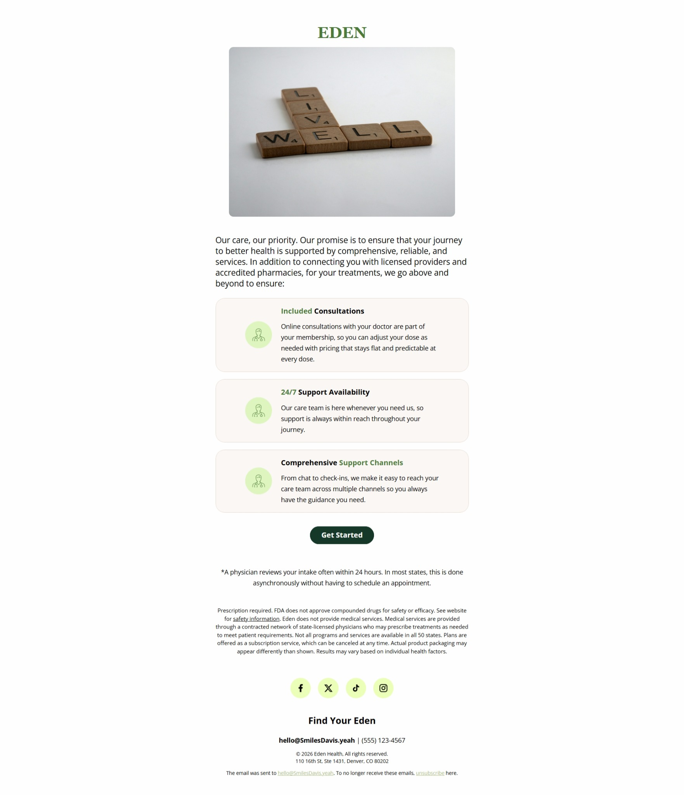

# Eden Health Email Recreation

A responsive marketing email recreated using MJML.

## Preview

## Built With

- MJML
- HTML Email
- Inline CSS
- VS Code

## Features

- Responsive email layout
- Two-column icon and text card layouts
- Rounded card designs
- Email-safe table-based structure
- Mobile-friendly design

## Development

The email was built in MJML and compiled into HTML.

Compile command:

mjml index.mjml -o index.html

## What I Learned

- Vertical alignment in MJML requires both columns to use `vertical-align="middle"` when centering content in a two-column layout.
- Email images are usually sized using `width` while allowing the height to scale automatically.
- Adding a wrapper after the body allows consistent spacing around all email content because `mj-body` does not support padding in the same way.
- When using an `mj-wrapper`, `<mj-spacer>` cannot be placed directly inside the wrapper. Used section padding (`<mj-section padding="0 0 16px">`) to create spacing between sections instead.
- Recreated a branded social icon row using `<mj-table>` instead of multiple columns, allowing precise control over icon spacing.

## Challenges Solved

- Fixed excessive spacing between social icons by replacing multiple columns with `mj-table`.
- Created two-column icon and text cards while learning MJML alignment and spacing techniques.
- Used wrapper padding to recreate the original email's consistent side spacing.